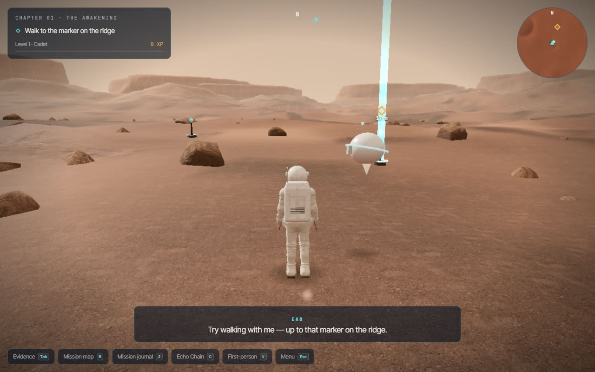
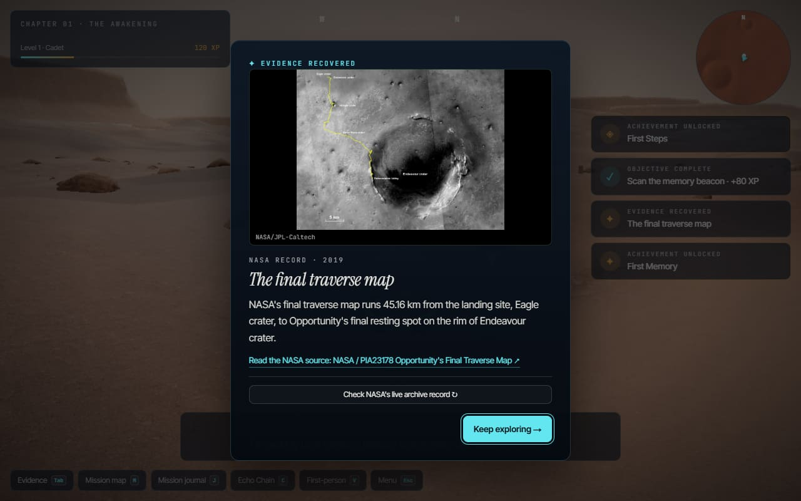
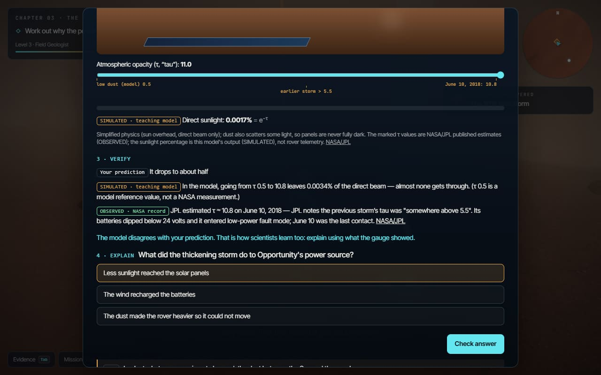
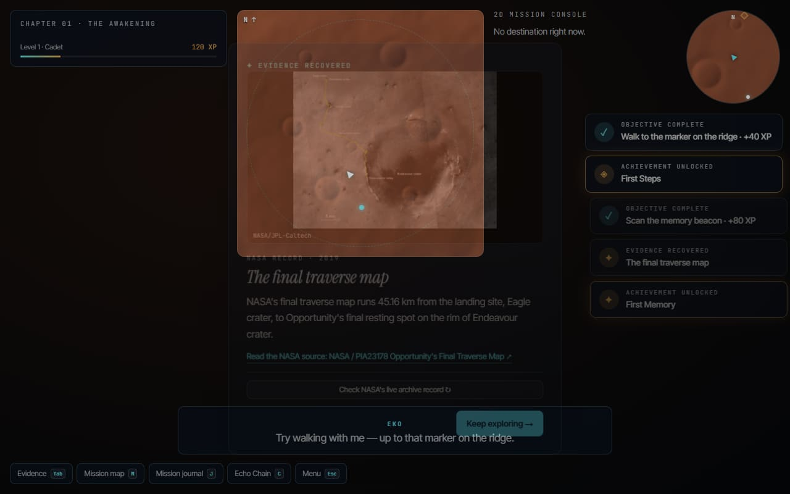

<div align="center">

# 🌌 Echoes Beyond Earth

### The machines went silent. The knowledge kept traveling.

**An interactive space-exploration museum and evidence-based learning adventure about the robotic missions humanity left on the Moon and Mars.**

[**Explore the experience**](https://echoes-beyond-earth.onrender.com/) · [**Play The Last Light**](https://echoes-beyond-earth.onrender.com/play/game/) · [**Take the quiz**](https://echoes-beyond-earth.onrender.com/play/quiz/) · [**Explore NASA sources**](https://echoes-beyond-earth.onrender.com/sources/)

[](https://nextjs.org/)
[](https://www.typescriptlang.org/)
[](https://threejs.org/)
[](https://react.dev/)
[](https://github.com/niloy-datta/echoes-beyond-earth/actions/workflows/eko-prototype-check.yml)

</div>

---

## Overview

What happens to a spacecraft's story after its final transmission?

**Echoes Beyond Earth** turns historical NASA mission records into an interactive experience. Visitors explore robotic exploration on the Moon and Mars, investigate original evidence, and learn to distinguish **verified observations, scientific interpretations, educational simulations, and artistic reconstructions**.

At its center is **The Last Light**, a five-chapter, third-person Mars adventure focused on the Opportunity rover's legacy, with a connected lunar evidence story about Surveyor 3 and Apollo 12. The experience combines exploratory gameplay, source-linked investigation, interactive science activities, and learning assessments.

> **Project status:** This repository contains an independently developed educational prototype. It is **not an official NASA product**, and NASA does not endorse or certify it. Any competition submission or reuse of pre-event work must follow the applicable organizer ruling; see [release and eligibility notes](EKO_RELEASE_GATE.md).

## Experience at a glance

| Experience | What you can do |
| --- | --- |
| **Interactive museum** | Explore rover stories, mission timelines, archival imagery, and source-linked exhibits. |
| **The Last Light** | Play five chapters on Mars, investigate Opportunity, and connect discoveries to lunar exploration. |
| **Evidence investigations** | Open historical evidence cards and optionally compare them with NASA's live image archive records. |
| **Echo Chain & Claim Check** | Build a *Hardware → Evidence → Discovery → Legacy* chain and classify supported versus unsupported claims. |
| **Science and quiz portal** | Play a five-question interactive mission quiz with instant feedback and replay, or complete chapter quizzes, pre/post assessments, adaptive practice, and data-interpretation exercises. |
| **Inclusive play modes** | Use 3D exploration or a 2D mission console, with keyboard/touch controls and accessibility settings. |
| **Learning records** | Save local progress, review completed objectives, and generate a printable learning summary. |

## Screenshots

| Mars exploration | Evidence investigation |
| :---: | :---: |
|  |  |
| **Storm science activity** | **2D mission console** |
|  |  |

*Screenshots are from the project demo; the virtual environment and dramatized scenes are artistic reconstructions, not actual NASA mission footage.*

## The Last Light — five chapters

| Chapter | Story and learning focus |
| --- | --- |
| **01 · The Awakening** | Learn to navigate Mars and discover the first mission record. |
| **02 · Footprints in the Dust** | Investigate Opportunity's wheels, solar panels, and Pancam system. |
| **03 · The Great Storm** | Predict outcomes, explore a simplified atmospheric-opacity model, and compare it with NASA/JPL observations. |
| **04 · Echoes of the Past** | Rebuild archived memories and investigate the Surveyor 3–Apollo 12 connection. |
| **05 · The Last Light** | Bring the recovered evidence together, evaluate claims, and complete the story. |

The game includes **automatic local saving and resume**, chapter progression, optional discoveries, achievements, and a **Judge preview** that demonstrates chapters without overwriting player saves or awarding progress. The 2D console uses the same underlying game session rather than a separate, unrelated story.

**Controls:** WASD / arrow keys to move, mouse to orbit, **E** to interact, **Tab** for evidence, **M** for map, **J** for journal, and **C** for Echo Chain. Touch devices provide an on-screen joystick and controls. For the full guide, see [GAME.md](GAME.md).

## Educational approach

The learning experience is designed around **investigation rather than passive reading**:

1. **Explore** a spacecraft, artifact, or mission event.
2. **Observe** the relevant NASA evidence and read its source.
3. **Experiment** with clearly labelled educational models when useful.
4. **Reason** about what the evidence proves, suggests, or does not support.
5. **Reflect** through quizzes, claim checks, and a local learning report.

The quiz portal includes parallel **10-question pre- and post-assessments**, chapter-based questions, optional challenges, and targeted practice. Scores distinguish first-try success from answers solved with help. **No improvement in learner outcomes is claimed without a real learner study.** See [learning methodology and data](docs/LEARNING_AND_DATA.md).

## NASA data and scientific provenance

NASA data is used as **evidence**, not just as visual decoration. The project distinguishes original records, derived results, simplified models, and fictional storytelling.

| Data / source | Implementation |
| --- | --- |
| [NASA Image and Video Library](https://images.nasa.gov/) | Mission imagery, evidence cards, and user-triggered live archive comparisons. |
| [NASA Photojournal](https://photojournal.jpl.nasa.gov/) and [JPL](https://www.jpl.nasa.gov/) | Opportunity mission history, rover imagery, and the 2018 dust-storm context. |
| [NASA 3D Resources](https://science.nasa.gov/3d-resources/mars-exploration-rover-opportunity-mer-b/) | Reference Opportunity 3D model used in the game. |
| [NASA Trek](https://trek.nasa.gov/) | Moon/Mars map imagery used by museum exploration. |
| [NASA NSSDCA](https://nssdc.gsfc.nasa.gov/) | Historical spacecraft reference records, with verification status tracked per record. |
| [NASA PDS](https://pds.nasa.gov/) — MER Pancam atmospheric opacity | Raw Opportunity opacity observations processed for the learning portal and storm-science comparisons. |

**Reproducible data example:** The repository includes original Pancam atmospheric-opacity files under `data/nasa/mer1-pancam-opacity/` and a processing script at `scripts/data/build-mer1-opacity.mjs`. The derived product is stored in `public/data/nasa/mer1-opacity.json`. The dataset ends on **June 5, 2018**; the later **June 10, 2018** opacity estimate is a separate cited JPL report, **not** a fabricated continuation of that dataset.

**Scientific integrity principles**

- Original NASA evidence, computed data, simulations, and artistic scenes have distinct labels.
- The project does not invent rover transmissions, telemetry, or famous “last words.”
- The Mars world layout and fictional companion **EKO** are not presented as actual mission geography or NASA systems.
- The source ledger uses project-maintained verification flags; these are not a substitute for independent scientific review.

See [data and learning documentation](docs/LEARNING_AND_DATA.md), [detailed game engineering notes](GAME.md), and the [release checklist](EKO_RELEASE_GATE.md) for evidence, caveats, and outstanding reviews.

## Technology

| Layer | Technologies |
| --- | --- |
| Web application | **Next.js 16**, React, TypeScript, Tailwind CSS |
| 3D experience | **Three.js**, GLTF/Draco assets, custom game simulation |
| Interactive maps | **MapLibre GL** |
| Motion and interface | Framer Motion, responsive React components |
| Authentication (optional) | Supabase Auth, browser-side email/password |
| Persistence | Browser `localStorage` for game and learning progress |
| Delivery | Static export (`out/`), deployable on static hosting |
| Validation | Node.js tests, TypeScript checks, data validators, browser smoke checks |

### Architecture

`src/app/` contains the site's routes, `src/components/` implements museum and learning interfaces, and `src/game/` separates content, simulation, rendering, input, and UI. In particular, the game session is decoupled from WebGL so the **3D renderer and 2D console share progression and objective logic**.

```text
src/
├── app/                 # Museum, game, quiz, evidence, and account routes
├── components/          # Museum exhibits and interactive interfaces
├── game/
│   ├── content/         # Chapters, puzzles, evidence, learning content
│   ├── core/            # Game session, progress, assessment, movement
│   ├── engine/          # Three.js world, models, and rendering
│   └── ui/              # HUD, menus, challenges, and 2D console
└── lib/                 # Localization, NASA integration, shared utilities
data/nasa/               # Committed original research data
public/                  # Static assets and derived public data
docs/                    # Research, demonstration material, screenshots
scripts/                 # Validation, build tooling, data processing
tests/                   # Automated unit and integration checks
UnityRealLook/           # Unity-related source/assets
```

## Getting started

**Requirements:** Node.js **22+** and npm. The core museum and game run without a backend or an account.

```bash
git clone https://github.com/niloy-datta/echoes-beyond-earth.git
cd echoes-beyond-earth
npm ci
npm run dev
```

Open **http://localhost:3000**.

### Optional authentication

Create `.env.local` only if you want to enable the optional sign-in experience:

```dotenv
NEXT_PUBLIC_SUPABASE_URL=your_supabase_project_url
NEXT_PUBLIC_SUPABASE_PUBLISHABLE_KEY=your_supabase_publishable_key
```

Enable email/password sign-in in Supabase and allowlist the exact `/login/` redirect URLs used locally and in production. Configure SMTP delivery if confirmation or password-reset emails will be used. **Never put a Supabase service-role or secret key into a `NEXT_PUBLIC_` variable.**

The game, its local progress, quizzes, and Judge preview do not require authentication.

### Check the project

```bash
npm run validate       # Check bundled source/data integrity
npm test               # Run automated tests
npm run typecheck      # TypeScript type checking
npm run quality:eko    # EKO-specific quality gate
npm run build          # Build the production static export
```

The build emits `out/`. For a local preview of the exported site, run `npm run start` after building. See [GitHub Actions](.github/workflows/) for automated checks.

## Accessibility and responsible design

- Keyboard and touch input, adjustable graphics quality, and a fallback **2D console** for devices without reliable WebGL.
- English and Bangla learning interfaces, subtitles, reduced-motion support, and optional browser speech where available.
- Local-only gameplay and learning records; the project does not report personal learner analytics to a server.
- Historical source attribution and visible distinctions between factual records and simulated content.

**Known validation gaps:** Real-world learner studies, independent Bangla science review, physical-device performance testing, and comprehensive assistive-technology testing remain open. As of November 14, 2026, the ledger lists 85 sources marked verified and zero marked required. Those labels are maintained by the team and do not constitute independent scientific certification.

## Project documentation

| Document | Purpose |
| --- | --- |
| [Game design and engineering](GAME.md) | Campaign, mechanics, controls, technical implementation, and known limitations |
| [Learning and NASA data](docs/LEARNING_AND_DATA.md) | Assessment methodology, PDS data provenance, and limitations |
| [Judge demo walkthrough](docs/JUDGE_DEMO.md) | Proposed demo flow and evidence-focused presentation |
| [Prototype notes](EKO_PROTOTYPE.md) | EKO prototype scope and development notes |
| [Release and eligibility checklist](EKO_RELEASE_GATE.md) | Reviews, performance checks, and competition permissions |

## Credits and acknowledgement

Created and maintained by **[Niloy Datta](https://github.com/niloy-datta)** with contributions from the project team. Development history remains available through the repository's commit records.

NASA and JPL imagery, mission pages, spacecraft resources, and planetary data remain credited to their original providers. Their availability does **not** imply NASA sponsorship, certification, or endorsement. Review the original sources and their usage guidance before reusing third-party assets.

---

<div align="center">

**Explore. Investigate. Question. Remember.**

[Live project](https://echoes-beyond-earth.onrender.com/) · [Source explorer](https://echoes-beyond-earth.onrender.com/sources/) · [Repository issues](https://github.com/niloy-datta/echoes-beyond-earth/issues)

</div>
